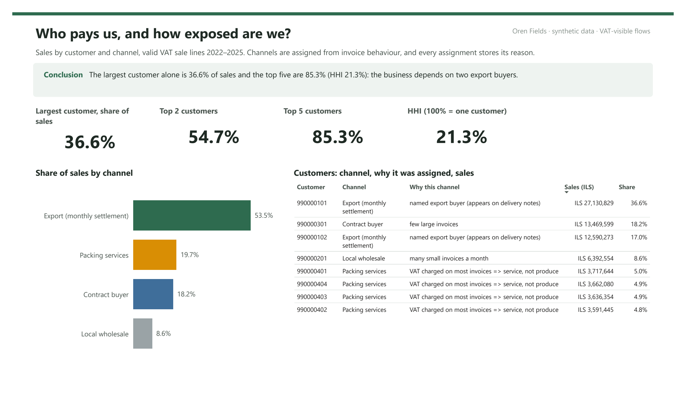
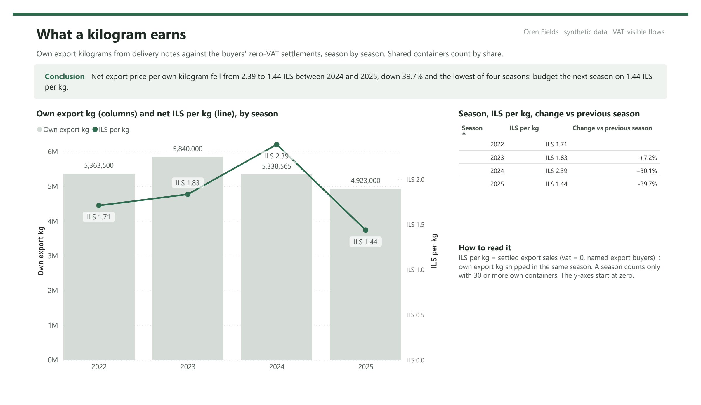
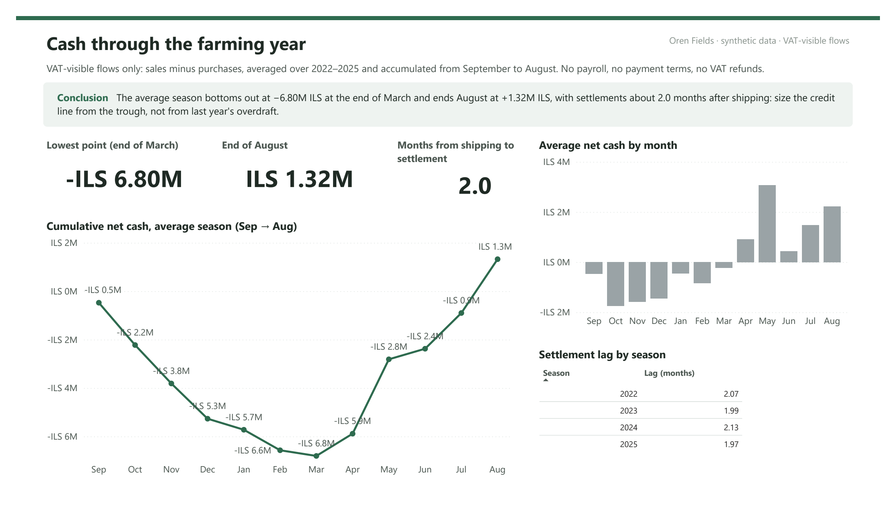
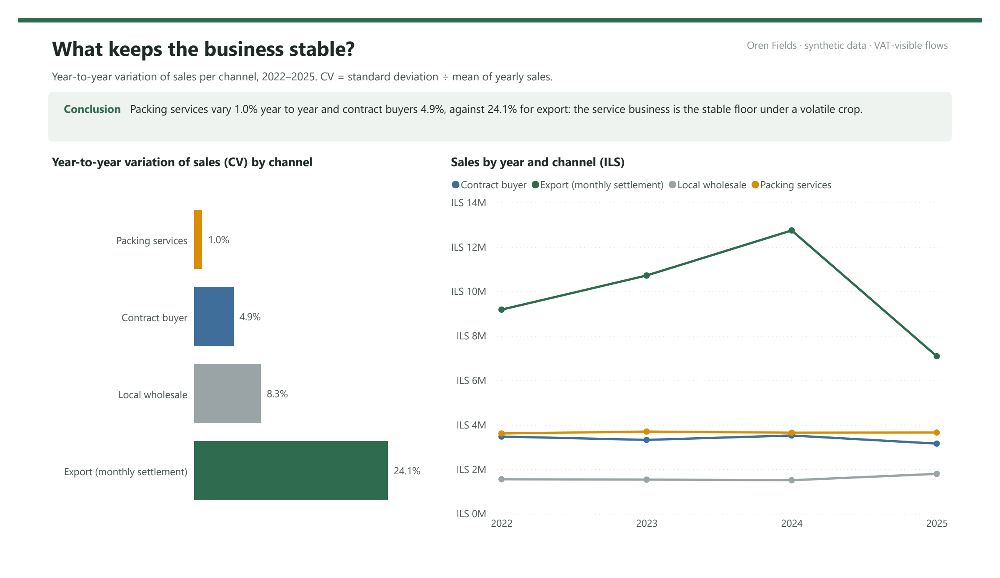
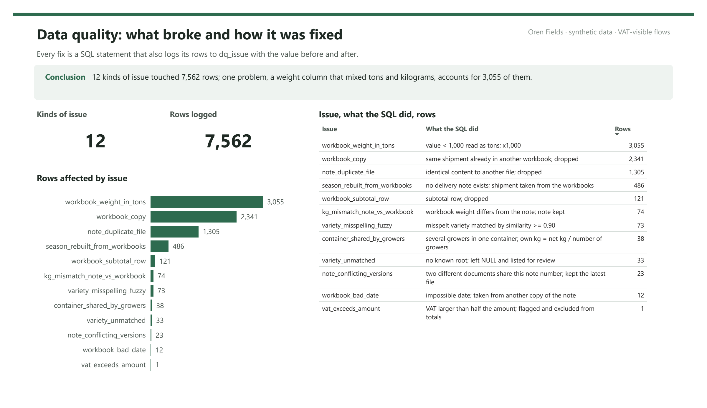
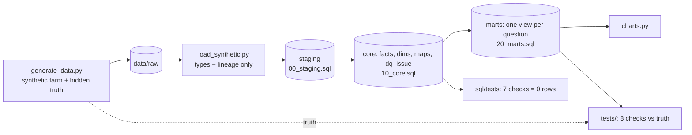

# A farm whose price per kg fell 40% in one season, and no record showed it

My family's farm keeps its business in delivery notes, Excel marketing sheets and VAT filings, none designed to be joined. I built a DuckDB warehouse that joins them, logs every fix, and answers four questions the owner had no number for.

[](https://github.com/ItamarBenEzra78/farm-records-to-decisions/actions/workflows/ci.yml)    

## TL;DR

- **Problem.** Export buyers pay one lump sum a month, one to three months after shipping. Nobody could say what a kilogram earned, who the business depends on, or how deep each season goes into the red.
- **Work.** A four-layer SQL warehouse (raw → staging → core → marts) over three sources with no shared key. 12 kinds of data problems and 7,562 issue rows logged in a `dq_issue` table, each with the value before and after. 7 SQL checks plus 8 tests against hidden ground truth run in CI.
- **Answers.**
  - Net price per kg **fell 40%** from 2024 to 2025.
  - The largest buyer alone is **37%** of sales.
  - The season sits **₪6–7M in the red** (VAT-visible flows) before buyers pay.
  - Packing-service revenue barely moves year to year (**CV 1%**), against 24% for export.

> All numbers here come from **synthetic data** that reproduces the structure and the mess of the real records. The same SQL runs privately on the farm's real data; those figures stay private. See [Real data](#real-data).

## The dashboard (Power BI)

Five pages on top of the SQL marts: the four questions below plus data quality. The model is a star schema exported by [`export_powerbi.py`](export_powerbi.py), with the measures written in DAX. Before the export is accepted, each of the 43 numbers on the pages is recomputed with the same logic and compared with the SQL marts; a mismatch fails the export and CI. Source: [`powerbi/`](powerbi/) (`.pbip` with TMDL model and PBIR report, plus the `.pbix`).

## The four questions

### 1. Who pays us, and how exposed are we?


Export buyers are the two counterparties named on delivery notes. The other customers are grouped by invoice behaviour in [`dim_counterparty`](sql/10_core.sql), and every assignment stores a `channel_reason`. Zero VAT cannot separate them, because fresh produce is VAT-exempt at home too. The top 5 customers are 85% of sales (HHI 0.21).
**Decision it supports:** a written limit on how much of a season goes to the largest buyer, and an early warning when it is exceeded.

### 2. What does a kilogram earn?


The farm's own export kg is matched to the buyers' zero-VAT settlements, season by season. Containers shared with other growers count by share.
**Decision it supports:** budget the next season on the worst observed price (₪1.44), not the last one.

```sql
-- sql/20_marts.sql (excerpt)
WITH kg AS (SELECT season, sum(own_kg) AS own_export_kg FROM fact_shipment GROUP BY season),
     ils AS (SELECT year AS season, sum(amount) AS settled_ils
             FROM fact_vat_line
             WHERE direction = 'sale' AND dq_flag IS NULL AND vat = 0
               AND counterparty IN (SELECT counterparty_id FROM cfg_buyer)
             GROUP BY year)
SELECT season, settled_ils / own_export_kg AS ils_per_kg,
       settled_ils / own_export_kg / lag(settled_ils / own_export_kg) OVER (ORDER BY season) - 1 AS change_vs_prev
FROM kg JOIN ils USING (season);
```

### 3. When does the money arrive?


Settlements arrive about **2.0 months** after shipping. On VAT-visible flows the average season bottoms out at the end of March at about **-₪6.8M** (₪5.8–6.8M across random seeds). Treat it as a lower bound: VAT data has no payroll, no supplier payment terms and no VAT refunds.
**Decision it supports:** size the seasonal credit line from this trough plus payroll, instead of from last year's overdraft.

### 4. What keeps the business stable?


Total packing revenue barely moves between years (CV 1%). Per container packed for other growers it works out at roughly **₪7,300–8,400**, an indicative ratio: service invoices and grower names are not linked in the data.
**Decision it supports:** price packing services and plan capacity as a business in their own right.

## Data challenges: what broke and how it was fixed



Counts from the `dq_summary` view (`SELECT * FROM dq_summary`), copied here from the latest build:

| Problem | Rows | Fix in SQL |
|---|---:|---|
| A "tons" column holding tons in some rows and kg in others | 3,055 | Values under 1,000 read as tons, ×1,000 |
| The same shipment copied into master and buyer workbooks | 2,341 | One row per note; a buyer sheet beats the master because it names the buyer |
| The same delivery note saved as several files | 1,305 | Content hash |
| **A season with 70% of its delivery notes lost** | 486 | Rebuilt from the workbooks, and every rebuilt row logged |
| "Total" rows in the middle of the shipments | 121 | Dropped. They would double-count kg |
| Workbook weight 1–3% off the note | 74 | Note kept, disagreement logged |
| **Misspelt varieties** ("Georgnia", "Moniqe", "Tysoon") | 73 | Jaro-Winkler match to known roots at ≥ 0.90 similarity. All recovered |
| Containers shared by two growers | 38 | Own kg = net kg ÷ number of growers |
| Varieties the dictionary has never seen | 33 | Left NULL and listed. Not guessed (a test enforces it) |
| A note re-issued with a corrected weight, under the same number | 23 | Latest version kept. A test checks the corrected weight wins |
| Dates in the years 254, 1987, 2052 | 12 | Taken from another copy of the same note |
| **A VAT line of ₪300,000,304 on a ₪1,900 purchase** | 1 | Flagged and excluded |

516 spellings mapped to 11 varieties; 38 spellings of grower names. The truth test requires at least 97% of shipments to get the right variety. This dataset reaches 100% only because its typos are single-letter errors; harder cases are what the 0.90 threshold and the unmatched list are for.

### Mistakes I made and caught

- **2024 price ₪2.58 instead of ₪2.40.** Rebuilt shipments with no buyer had been dropped from the kg but not from the money. Both buyers settle into one pot, so all own kg must count.
- **A yield per dunam that was physically impossible.** This happened on the real data. The calculation counted only produce entering the packing house and missed containers that went straight to export. It was caught because the number could not be true.
- **Shared containers counted twice, then not at all.** My first pandas version counted a shared container as fully the farm's; the first SQL version counted it as zero. On the real data the two versions disagreed badly. Splitting by number of growers ended the disagreement.

## How it is built



- **Raw → staging:** a loader only types columns and keeps `source_file` and `row_num`. No cleaning happens in Python.
- **Core:** every fix is a SQL statement that also inserts its rows into `dq_issue`. The configuration lives in `cfg_*` tables: spelling roots, buyer names, the role of each workbook.
- **Marts:** one view per question. The charts and this README read only from marts.

```bash
pip install -r requirements.txt
python generate_data.py     # messy records + hidden truth
python build.py             # db/farm.duckdb, 7 SQL checks
pytest -q                   # 8 checks against the truth
python charts.py            # reports/figures + reports/summary.json
python export_powerbi.py    # powerbi/data star schema + expected.csv (43 checked numbers)
```

## Real data

The same `sql/` runs on my family's farm through a private loader: `python build.py --loader load_real.py --db real.duckdb`. On the real records (2023–2026) it fixed:

| Problem | Rows |
|---|---:|
| Blank grower names | 538 |
| Subtotal rows | 212 |
| A season rebuilt from workbooks | 188 shipments |
| Containers shared by growers | 57 |
| Note-vs-workbook weight disagreements | 33 |
| Re-issued notes | 24 |
| Misspelt varieties matched | 17 |
| Unknown varieties, listed and not guessed | 10 |
| Corrupt VAT lines | 2 |

All 7 SQL checks pass on the real data too. Earlier extraction steps ran on the farm's workstation: 549 VAT files covering 217 monthly reports, 4,237 delivery notes (3,406 duplicates removed), 55 workbooks, and 1,226 spellings of 47 varieties. Personal ID numbers were replaced with codes before anything left that machine.

**What the data cannot say:**
- **Price per variety.** Buyers settle in lump sums. I recommended keeping their sales statements.
- **Profit.** Costs are not split by crop.
- **About 40% of delivery notes.** They are handwritten scans, which were counted and not guessed.

Part 1, reverse-engineering the undocumented VAT file format, is in [pcn874-vat-analytics](https://github.com/ItamarBenEzra78/pcn874-vat-analytics).
